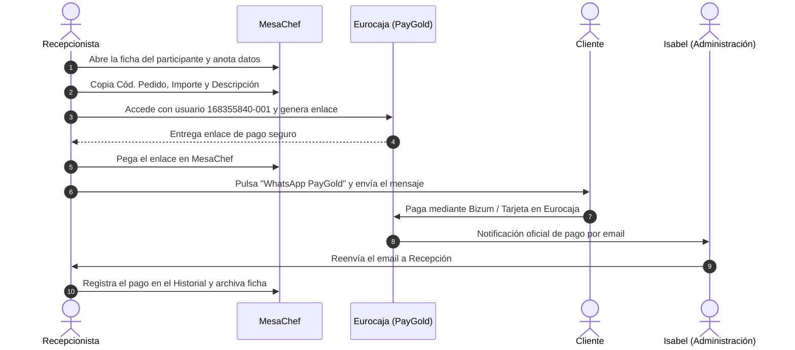
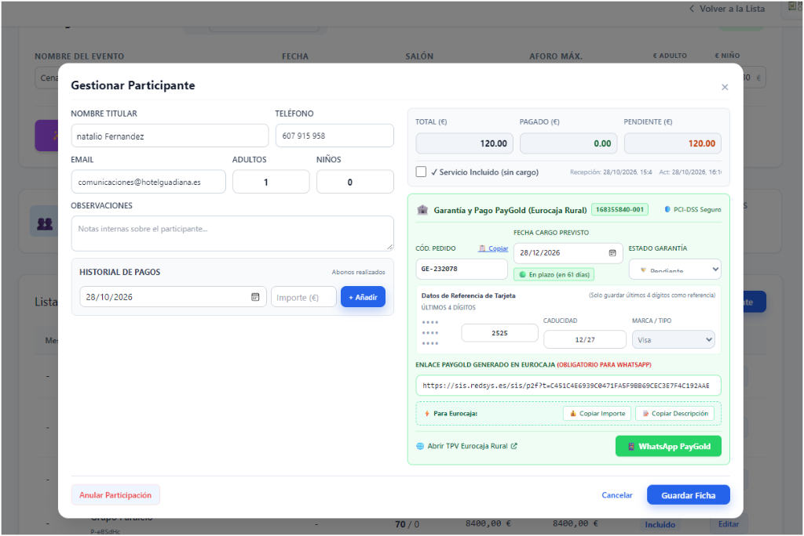
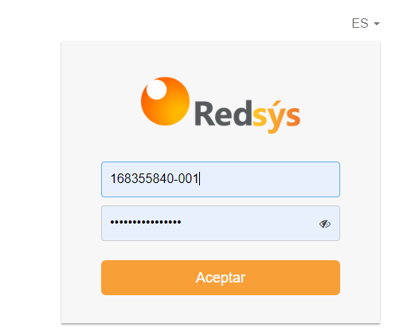
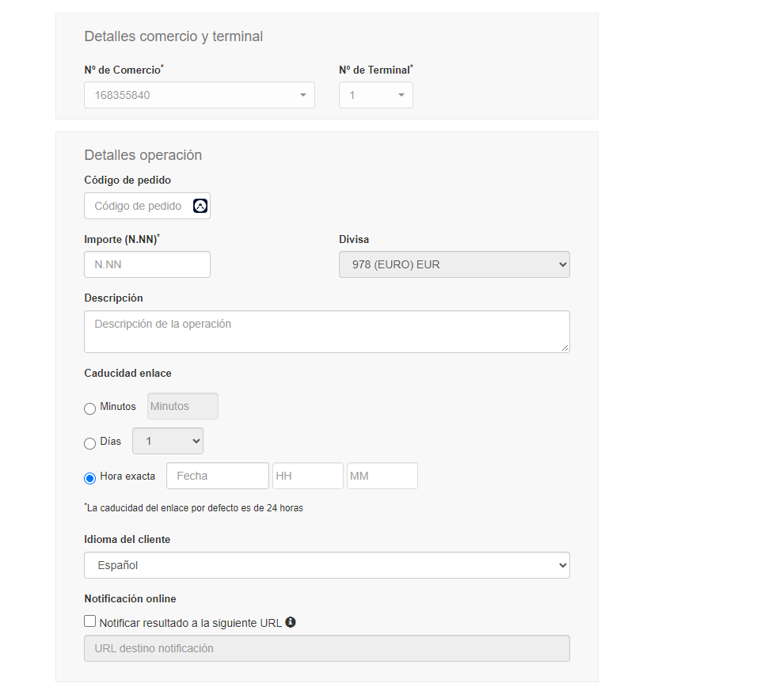
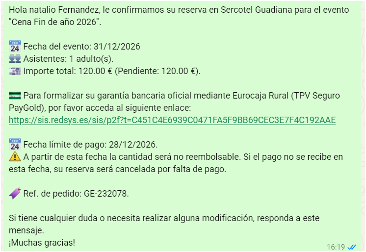
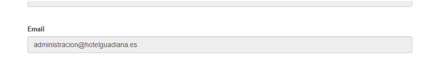

# 📖 Manual Operativo para Recepción: Gestión de Pagos y Garantías PayGold (Sercotel Guadiana)

Este manual detalla paso a paso el procedimiento oficial que el equipo de Recepción debe seguir para registrar reservas, generar enlaces seguros de pago en Eurocaja Rural (PayGold), enviar la confirmación por WhatsApp y coordinar los cobros con Administración.

---

## 📌 Datos Clave de Acceso y Configuración

| Concepto | Detalle Oficial |
| :--- | :--- |
| **Establecimiento** | Sercotel Guadiana |
| **Entidad Bancaria** | Eurocaja Rural (Redsys) |
| **Usuario / Terminal TPV** | `168355840-001` |
| **Portal de Acceso TPV** | [https://canales.redsys.es/portal](https://canales.redsys.es/portal) |
| **Email de Avisos de Pago** | `administracion@hotelguadiana.es` (Isabel) |
| **Circuito de Confirmación** | Isabel recibe el justificante de Eurocaja y lo **reenvía a Recepción** para control. |

---

## 🔄 Resumen del Circuito de Cobro

---

## 📝 Procedimiento Paso a Paso

### PASO 1: Apertura de la Ficha en MesaChef

1. En el módulo **Grandes Eventos** de MesaChef, localiza la reserva o pulsa **+ Añadir Participante**.
2. Rellena los datos de la reserva:
   * **Nombre Titular:** Nombre completo del cliente.
   * **Teléfono:** 9 dígitos (ej. `607 915 958`).
   * **Comensales:** Adultos y Niños.
   * **Fecha Cargo Previsto:** Selecciona la fecha límite de pago (ej. `28/12/2026`).

> [!CAUTION]
> **REGLA DE ORO DE SEGURIDAD (PCI-DSS):**
> **NUNCA apuntar números de tarjeta de 16 dígitos en el recuadro "Observaciones"**.  
> Si el cliente facilita su tarjeta por teléfono, anota **únicamente los últimos 4 dígitos** (ej. `2525`) en su casilla correspondiente. El cobro oficial se realiza exclusivamente a través del enlace de Eurocaja Rural.

---

### PASO 2: Acceso al TPV Virtual de Eurocaja Rural

1. En la ficha de MesaChef, pulsa en el enlace azul: **🌐 Abrir TPV Eurocaja Rural**.
2. Introduce las credenciales oficiales de acceso:
   * **Usuario:** `168355840-001` *(importante: debe incluir el terminal `-001`)*.
   * **Contraseña:** La contraseña asignada al TPV de recepción.
   * Pulsa **Aceptar**.

---

### PASO 3: Generación del Enlace PayGold en Eurocaja

1. En el menú lateral izquierdo de Eurocaja Rural, haz clic en **PayGold** (icono verde con tarjeta y flecha).
2. Rellena las 3 casillas utilizando los **botones de copia rápida** de MesaChef:
   * **Código de pedido:** Pulsa **`📋 Copiar`** en MesaChef y pégalo aquí (`Ctrl + V`). *(Ejemplo: `GE-232078`)*.
   * **Importe:** Pulsa **`💰 Copiar Importe`** en MesaChef y pégalo aquí (`Ctrl + V`). *(Ejemplo: `120.00`)*.
   * **Descripción:** Pulsa **`📝 Copiar Descripción`** en MesaChef y pégalo aquí (`Ctrl + V`).  
     *Formato oficial:* `Cena Fin de Año - [Nombre del Cliente]` *(Ej: `Cena Fin de Año 2026 - Natalio Fernandez`)*.
3. En **Caducidad del enlace**, selecciona la fecha límite acordada o déjala por defecto.
4. Pulsa el botón **Aceptar / Enviar**: el banco generará el enlace oficial seguro (ej. `https://sis.redsys.es/sis/p2f?t=...`).
5. **Copia ese enlace.**

---

### PASO 4: Envío del WhatsApp de Confirmación al Cliente

1. Vuelve a la ficha del participante en **MesaChef**.
2. Pega el enlace en la casilla:  
   👉 **Enlace PayGold generado en Eurocaja (Obligatorio para WhatsApp)**.
3. Haz clic en el botón verde: **`📱 WhatsApp PayGold`**.
4. Se abrirá WhatsApp Web / App con el mensaje redactado automáticamente:
   * Nombre del cliente y del evento (*Cena Fin de año 2026 en Sercotel Guadiana*).
   * Número de asistentes e importes.
   * Enlace oficial seguro de Eurocaja Rural para pagar con Bizum o Tarjeta.
   * **Cláusula de cancelación obligatoria:**
     > *"A partir de esta fecha la cantidad será no reembolsable. Si el pago no se recibe en esta fecha, su reserva será cancelada por falta de pago."*
5. Envía el mensaje y pulsa **Guardar Ficha** en MesaChef. El estado cambiará a `📤 Enlace Enviado`.

---

### PASO 5: Notificación y Circuito con Administración (Isabel)

1. Cuando el cliente realiza el pago a través del enlace de Eurocaja Rural, el banco envía automáticamente un correo electrónico de confirmación con el justificante y el código de pedido (`GE-XXXXXX`).
2. Este aviso llega a la cuenta oficial de administración:  
   📧 **`administracion@hotelguadiana.es`** (gestionada por **Isabel**).

3. **Acción de Isabel:** Isabel comprueba el abono y **lo reenvía de inmediato por email a Recepción** para su control operativo.
4. **Acción final de Recepción:**
   * Abre la ficha del participante en MesaChef buscando por el código de pedido o nombre del cliente.
   * En el bloque **Historial de Pagos**, introduce la fecha, el importe abonado y pulsa **+ Añadir**.
   * Cambia el desplegable de **Estado Garantía** a: `✅ Garantizado / Pagado`.
   * Pulsa **Guardar Ficha**.

---

## ❓ Preguntas Frecuentes y Resolución de Incidencias

> [!TIP]
> **¿Qué pasa si el cliente no paga antes de la fecha límite?**
> En la tabla de participantes de Grandes Eventos, la reserva mostrará la alerta roja:  
> `⚠️ Vencido: DD/MM/AAAA`.  
> Recepción debe llamar al cliente o, si no responde, proceder a la cancelación de la reserva por falta de pago según la política informada.

> [!NOTE]
> **¿Por qué el usuario de Eurocaja debe ser 168355840-001?**
> El sufijo `-001` identifica el Terminal 1 asignado al Hotel Guadiana para cobros a distancia PayGold. Sin este sufijo, el sistema del banco no permitirá iniciar sesión.
