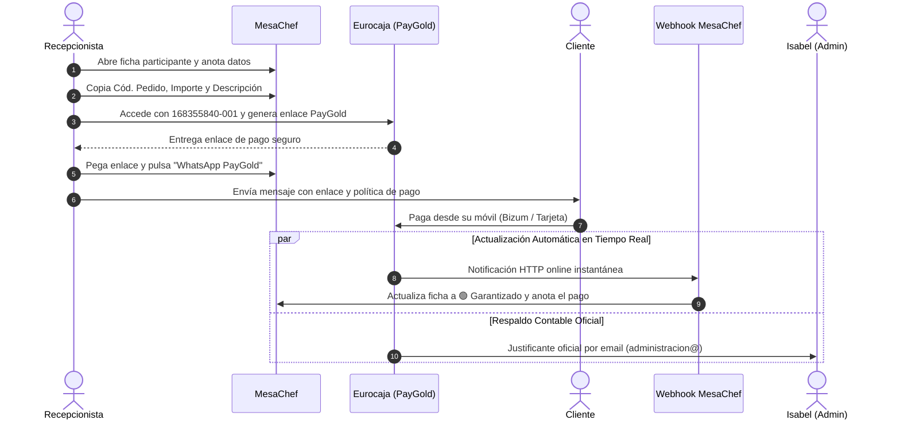

# 📖 Manual Operativo para Recepción: Gestión de Pagos y Garantías PayGold (Sercotel Guadiana)

Este manual detalla paso a paso el procedimiento oficial que el equipo de Recepción debe seguir para registrar reservas, generar enlaces seguros de pago en Eurocaja Rural (PayGold), enviar la confirmación por WhatsApp, la sincronización automática online y la coordinación de cobros con Administración.

---

## 📌 Datos Clave de Acceso y Configuración

| Concepto | Detalle Oficial |
| :--- | :--- |
| **Establecimiento** | Sercotel Guadiana |
| **Entidad Bancaria** | Eurocaja Rural (Redsys) |
| **Usuario / Terminal TPV** | `168355840-001` |
| **Portal de Acceso TPV** | [https://canales.redsys.es/portal](https://canales.redsys.es/portal) |
| **URL Notificación Online (Webhook)** | `https://europe-west1-mesa-chef-prod.cloudfunctions.net/redsysWebhook` |
| **Sincronización Automática** | Instantánea: MesaChef pasa a 🟢 Garantizado y anota el pago al momento |
| **Email de Avisos de Pago** | `administracion@hotelguadiana.es` (Isabel) |
| **Circuito de Conciliación** | Isabel recibe el justificante oficial de Eurocaja para control contable y facturación. |

---

## 🔄 Resumen del Circuito de Cobro (Automático + Respaldo Contable)

---

## 🛡️ Seguridad Total: ¿Por qué es Vital Utilizar el Enlace PayGold?

La razón primordial por la que **NUNCA debemos pedir ni escribir tarjetas de crédito completas de 16 dígitos en notas ni en el campo de "Observaciones"** es proteger legalmente al hotel y a cada uno de los empleados de recepción:

1. **Prevención de Filtraciones y Responsabilidad Legal (RGPD & PCI-DSS):**  
   Almacenar datos completos de tarjetas en texto plano en ordenadores o libretas incumple la normativa bancaria internacional PCI-DSS y el RGPD. Ante cualquier filtración, inspección o brecha de seguridad, el hotel se enfrenta a **sanciones de hasta el 4% de la facturación y multas de Visa/Mastercard de hasta 100.000 €**, además de la cancelación inmediata del TPV. Con PayGold, **el hotel nunca almacena la tarjeta**, por lo que no existe ningún dato que pueda filtrarse.

2. **Blindaje contra Fraudes y Falsas Devoluciones (3D Secure / PSD2):**  
   Si el hotel cobrase una tarjeta manualmente tecleando los números en el datáfono, el cliente puede llamar a su banco al día siguiente diciendo *"yo no autoricé este cobro"*. Por ley, el banco siempre le devuelve el dinero al cliente y el hotel pierde el dinero de la cena. Con el enlace PayGold, **el cliente autoriza en su propia app bancaria (con huella, Face ID o SMS)**. Legalmente se produce el traspaso de responsabilidad (*Liability Shift*) y **el cliente NO puede repudiar el cobro**.

3. **Tranquilidad para el Personal de Recepción:**  
   Al no ver ni guardar tarjetas de clientes, ningún recepcionista puede ser jamás objeto de sospecha si a ese cliente le clonan la tarjeta en otro comercio. En MesaChef solo dejamos constancia de los últimos 4 dígitos (ej. `•••• 2525`) como simple referencia visual.

---

## 📝 Procedimiento Paso a Paso

### PASO 1: Apertura de la Ficha en MesaChef

1. En el módulo **Grandes Eventos** de MesaChef, localiza la reserva o pulsa **+ Añadir Participante**.
2. Rellena los datos de la reserva:
   * **Nombre Titular:** Nombre completo del cliente.
   * **Teléfono:** 9 dígitos (ej. `607 915 958`).
   * **Comensales:** Adultos y Niños.
   * **Fecha Cargo Previsto:** Selecciona la fecha límite de pago (ej. `28/12/2026`).

> [!CAUTION]
> **REGLA DE ORO DE SEGURIDAD (PCI-DSS):**
> **NUNCA apuntar números de tarjeta de 16 dígitos en el recuadro "Observaciones"**.  
> Si el cliente facilita su tarjeta por teléfono, anota **únicamente los últimos 4 dígitos** (ej. `2525`) en su casilla correspondiente. El cobro oficial se realiza exclusivamente a través del enlace de Eurocaja Rural.

---

### PASO 2: Acceso al TPV Virtual de Eurocaja Rural

1. En la ficha de MesaChef, pulsa en el enlace azul: **🌐 Abrir TPV Eurocaja Rural**.
2. Introduce las credenciales oficiales de acceso:
   * **Usuario:** `168355840-001` *(importante: debe incluir el terminal `-001`)*.
   * **Contraseña:** La contraseña asignada al TPV de recepción.
   * Pulsa **Aceptar**.

---

### PASO 3: Generación del Enlace PayGold en Eurocaja

1. En el menú lateral izquierdo de Eurocaja Rural, haz clic en **PayGold** (icono verde con tarjeta y flecha).
2. Rellena las 3 casillas utilizando los **botones de copia rápida** de MesaChef:
   * **Código de pedido:** Pulsa **`📋 Copiar`** en MesaChef y pégalo aquí (`Ctrl + V`). *(Ejemplo: `GE-232078`)*.
   * **Importe:** Pulsa **`💰 Copiar Importe`** en MesaChef y pégalo aquí (`Ctrl + V`). *(Ejemplo: `120.00`)*.
   * **Descripción:** Pulsa **`📝 Copiar Descripción`** en MesaChef y pégalo aquí (`Ctrl + V`).  
     *Formato oficial:* `Cena Fin de Año - [Nombre del Cliente]` *(Ej: `Cena Fin de Año 2026 - Natalio Fernandez`)*.
3. **Caducidad del enlace (OBLIGATORIO):** Marca la opción **"Hora exacta"** e introduce **exactamente la misma Fecha Límite de Pago** fijada en MesaChef para este evento (ej. `Fecha: 28-12-2026`, `Hora: 23:59`). **NUNCA dejar las 24 horas por defecto**, para que el enlace expire exactamente el día acordado.
4. Pulsa el botón **Aceptar / Enviar**: el banco generará el enlace oficial seguro (ej. `https://sis.redsys.es/sis/p2f?t=...`).
5. **Copia ese enlace.**

---

### PASO 4: Envío del WhatsApp de Confirmación al Cliente

1. Vuelve a la ficha del participante en **MesaChef**.
2. Pega el enlace en la casilla:  
   👉 **Enlace PayGold generado en Eurocaja (Obligatorio para WhatsApp)**.
3. Haz clic en el botón verde: **`📱 WhatsApp PayGold`**.
4. Se abrirá WhatsApp Web / App con el mensaje redactado automáticamente:
   * Nombre del cliente y del evento (*Cena Fin de año 2026 en Sercotel Guadiana*).
   * Número de asistentes e importes.
   * Enlace oficial seguro de Eurocaja Rural para pagar con Bizum o Tarjeta.
   * **Cláusula de cancelación obligatoria:**
     > *"A partir de esta fecha la cantidad será no reembolsable. Si el pago no se recibe en esta fecha, su reserva será cancelada por falta de pago."*
5. Envía el mensaje y pulsa **Guardar Ficha** en MesaChef. El estado cambiará a `📤 Enlace Enviado`.

---

### PASO 5: Actualización Automática (Webhook) y Conciliación Contable

Gracias a la integración del **Webhook Online de Redsys**, el sistema funciona ahora de manera autónoma:

1. **Sincronización Automática en Tiempo Real (MesaChef):**
   * En el instante en que el cliente completa el pago desde su teléfono (mediante Bizum o tarjeta), Eurocaja Rural envía una señal silenciosa a MesaChef.
   * **MesaChef actualiza automáticamente la ficha:**
     - Cambia el estado a **`✅ Garantizado / Pagado`**.
     - Anota el abono en el **Historial de Pagos** con la fecha y código de autorización del banco.
     - Guarda los últimos 4 dígitos y caducidad para referencia del hotel.
   * **El personal de Recepción NO necesita hacer nada a mano**: al consultar la lista de participantes verá el semáforo verde inmediatamente.

2. **Control y Conciliación con Administración (Isabel):**
   * Eurocaja Rural sigue enviando de forma paralela el correo con el justificante oficial a **`administracion@hotelguadiana.es`** (**Isabel**).
   * **Función de este email:** Sirve a Isabel para la cuadratura contable y la conciliación mensual con el extracto bancario de Eurocaja Rural.
   * **Recepción ya no tiene que esperar el correo:** Dado que MesaChef se actualiza al segundo, Recepción puede continuar atendiendo sin demoras.

---

## ❓ Preguntas Frecuentes y Resolución de Incidencias

> [!TIP]
> **¿Cómo sé si un cliente ya ha pagado sin entrar a su ficha?**  
> En la tabla principal de participantes de Grandes Eventos, la columna **Garantía PayGold** mostrará el distintivo verde **`✅ Garantizado`** y el importe pendiente quedará a **`0,00 €`**.

> [!TIP]
> **¿Qué pasa si el cliente no paga antes de la fecha límite?**  
> En la tabla de participantes de Grandes Eventos, la reserva mostrará la alerta roja:  
> `⚠️ Vencido: DD/MM/AAAA`.  
> Recepción debe llamar al cliente o, si no responde, proceder a la cancelación de la reserva por falta de pago según la política informada.

> [!NOTE]
> **¿Por qué el usuario de Eurocaja debe ser 168355840-001?**  
> El sufijo `-001` identifica el Terminal 1 asignado al Hotel Guadiana para cobros a distancia PayGold. Sin este sufijo, el sistema del banco no permitirá iniciar sesión.
